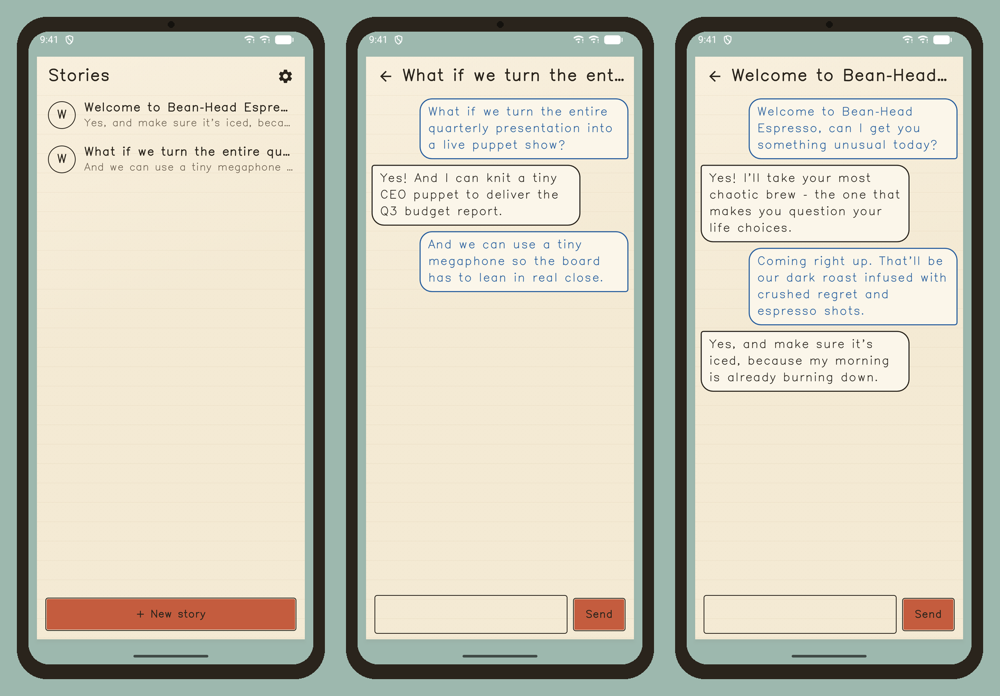
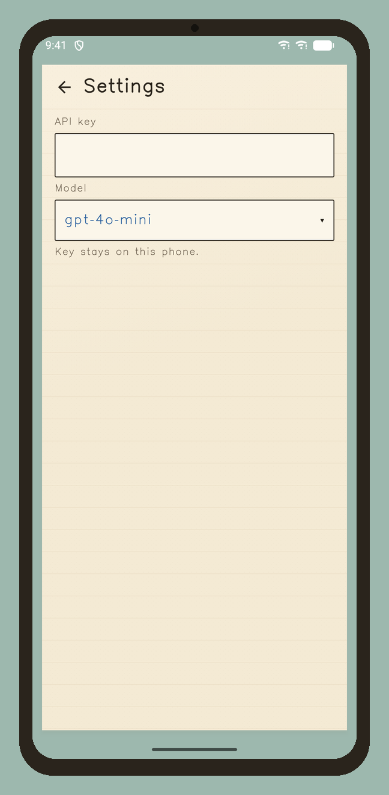

# S.andy

You type a line. S.andy says yes, and then adds one.

A small Android story pad. Paper on a desk. No accounts. Your OpenAI key stays on the phone.

## What it looks like

Stories on the left. Open one in the middle. Keep saying yes, and it builds on the right.

<p align="center">
  
</p>

You are blue on the right. S.andy is ink on the left.

## How to set it up

1. Open **Settings**.
2. Paste your OpenAI API key. Hidden while you type. It stays on this phone except when talking to OpenAI.
3. Model: leave `gpt-4o-mini` unless you have a reason not to.
4. Back. Hit **+ New story**. Send one line.

<p align="center">
  
</p>

If the key is missing or refused, red pencil says so. Fix it, then Send. Your last line is still there.

Empty new sheet + Back = nothing saved.

Try an ordinary first line:

- Welcome to Bean-Head Espresso, can I get you something unusual today?
- What if we turn the entire quarterly presentation into a live puppet show?

## Get it on a phone

There is no APK in this repo. You build it onto a device. Need **JDK 17** and [Android platform-tools](https://developer.android.com/tools/releases/platform-tools) (`adb`).

Clone this repo first.

### Real phone, Wi-Fi debugging

Phone and computer on the same Wi-Fi.

1. On the phone: **Settings → Developer options → Wireless debugging**. Turn it on.
2. Tap **Pair device with pairing code**. Note the IP, pair port, and 6-digit code.
3. On the computer:

```bash
adb pair IP:PAIR_PORT
```

Type the code when asked. Then connect (the connect port is different from the pair port; the Wireless debugging screen shows it):

```bash
adb connect IP:CONNECT_PORT
adb devices
```

You want `device`, not `offline`.

4. From the repo:

```bash
./gradlew installDebug
```

5. Open **S.andy** on the phone.

If `adb devices` is empty, toggle Wireless debugging off/on and pair again.

### Android emulator

1. Android Studio → **Device Manager** → a Pixel (API 26+).
2. Start it.
3. From the repo:

```bash
./gradlew installDebug
```

If both a phone and an emulator show up, pick one:

```bash
adb devices
ANDROID_SERIAL=emulator-5554 ./gradlew installDebug
```

Then paste a key in Settings.
