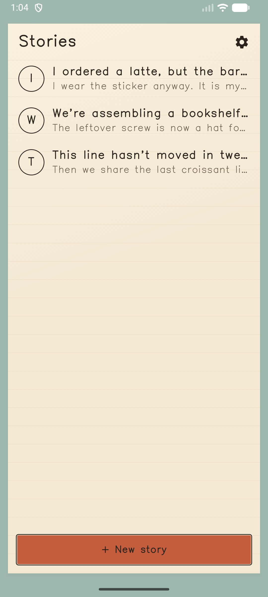
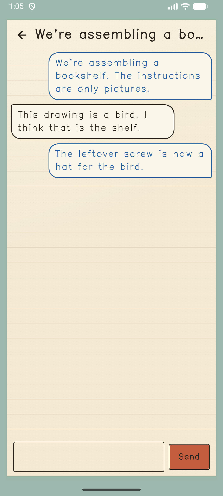
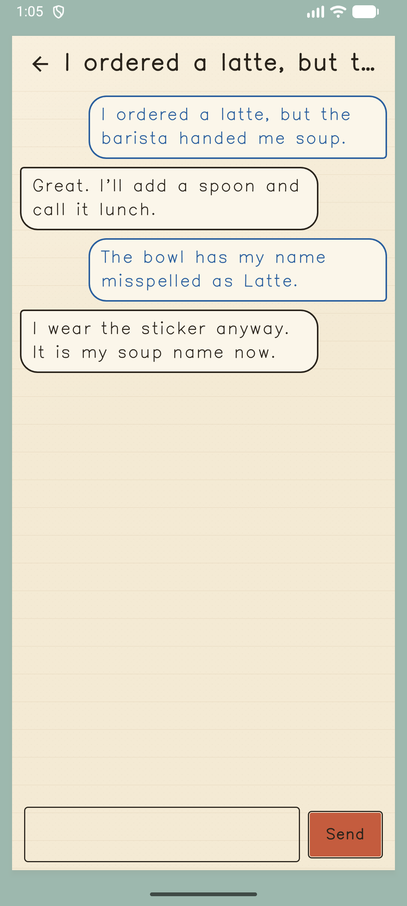
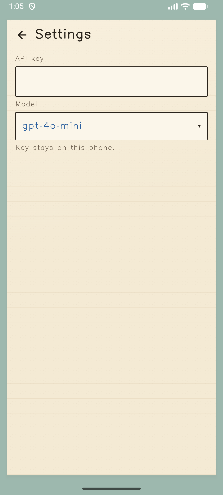

# S.andy

You type a line. S.andy says yes, and then adds one.

A small Android story pad. Paper on a desk. No accounts. Your OpenAI key stays on the phone.

## What it looks like

Stories sit in a list, newest first. Title is your opening line. Subtitle is whatever landed last.



Open one. You write on the right (blue). S.andy writes on the left (ink). Short lines. Keep going.



A few more yes-ands and the scene is a thing. Accept what showed up, then add something new.



## How to set it up

1. Install the app on your phone.
2. Open **Settings**.
3. Paste your OpenAI API key. It is hidden as you type. It never leaves the device except to call OpenAI.
4. Pick a model. `gpt-4o-mini` is the default and is plenty for this.
5. Back. Start a story.



If the key is missing or refused, S.andy tells you in red pencil. Fix it in Settings, then Send again. Your last line is still there.

## Try a first line

Anything ordinary works. S.andy will treat it as true.

- I ordered a latte, but the barista handed me soup.
- We're assembling a bookshelf. The instructions are only pictures.
- This line hasn't moved in twenty minutes.

Back with an empty sheet does not save a story. Send one line, then it lands in the list.

## Run it

Need JDK 17.

```bash
./gradlew installDebug
```

Then paste a key in Settings.
